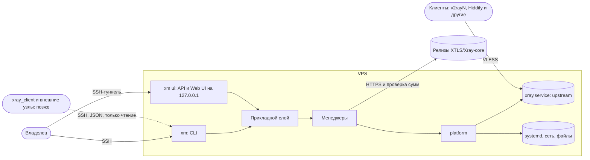
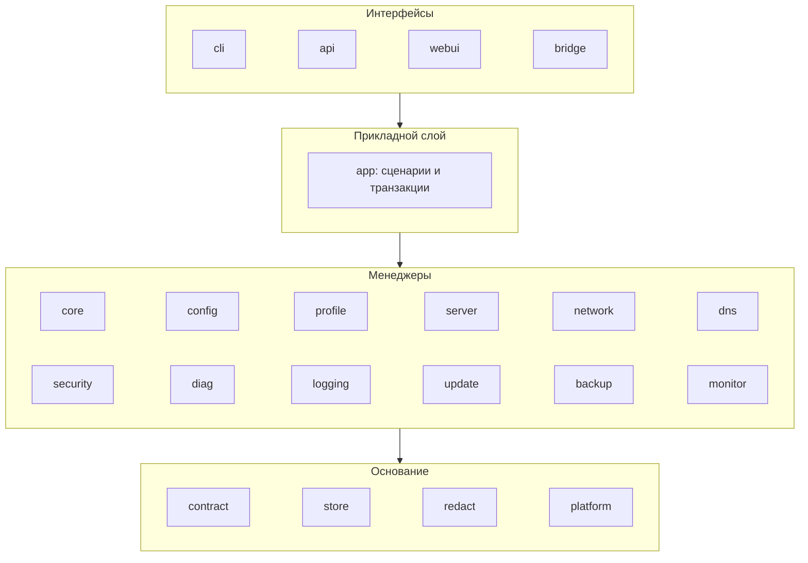
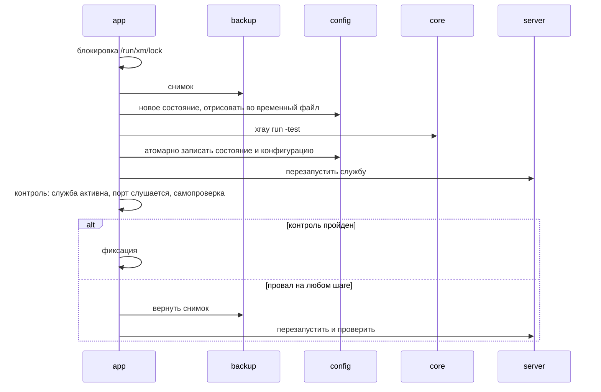

# Архитектура: обзор

Что получается в итоге. Почему так и что отвергнуто — в [ADR](../adr/README.md); нерешённое —
в [открытых вопросах](../open-questions.md).

## 1. Назначение и границы

`xm` — менеджер официального Xray-core на одном VPS: ставит, настраивает, обновляет, обслуживает
и диагностирует его так, чтобы владельцу не пришлось разбираться в сетевой конфигурации.

| Делает | Не делает |
|---|---|
| Ставит и обновляет upstream-бинарник Xray с проверкой целостности и откатом | Не форкает, не патчит и не линкует Xray-core |
| Строит конфигурацию Xray из своего состояния и применяет её транзакционно | Не обещает обход DPI и блокировок |
| Ведёт клиентские профили, выдаёт VLESS URI и QR | Не управляет клиентскими устройствами |
| Диагностирует сервер и сеть, разделяя факты и гипотезы | Не выдаёт предположение о фильтрации за доказанное |
| Даёт CLI и локальный Web UI через SSH-туннель | Не открывает административный интерфейс в интернет |
| Делает резервные копии и восстанавливает | Не меняет SSH и фаервол без явной команды владельца |

## 2. Принципы

1. **Upstream отдельно.** Xray-core — внешний бинарник; всё взаимодействие — через его файл
   конфигурации, подкоманды и службу ([ADR-0001](../adr/0001-xray-upstream-binary.md)).
2. **Одно состояние.** Источник правды — `state.json`; конфигурация Xray — производный артефакт,
   руками не правится ([ADR-0004](../adr/0004-state-and-rendered-config.md)).
3. **Изменение — транзакция.** Снимок → проверка → применение → контроль → фиксация или откат
   ([ADR-0005](../adr/0005-transactions-and-rollback.md)).
4. **Один прикладной слой — много интерфейсов.** CLI, HTTP API и мост вызывают одни и те же
   сценарии и отдают один версионируемый контракт ([ADR-0006](../adr/0006-interfaces-and-contract.md)).
5. **Побочные эффекты — через один порт.** Процессы, файлы, systemd, сокеты — только пакет
   `platform`; всё остальное тестируется без системы.
6. **Секреты не покидают VPS.** Наружу (логи, отчёты, экспорт) — только через редактор
   ([ADR-0010](../adr/0010-secrets-and-redaction.md)).
7. **Нет резидентных процессов менеджера.** В простое на VPS работает только Xray
   ([ADR-0003](../adr/0003-process-model.md)).
8. **Один путь.** Без запасных веток, деградированных режимов и альтернативных реализаций, пока
   они явно не запрошены. Откат транзакции — требование, а не запасная ветка.
9. **Факт ≠ гипотеза.** У каждого вывода диагностики — класс и ограничения измерения
   ([ADR-0011](../adr/0011-diagnostics-evidence-model.md)).
10. **Устаревающее — данными.** Совместимость клиентов, пресеты, список проверок — таблицы и
    реестры, а не ветвления в коде.

## 3. Контекст

## 4. Слои и компоненты

Правило зависимостей: импорт только вниз по слоям; менеджеры не импортируют друг друга — нужную
возможность соседа менеджер объявляет у себя узким интерфейсом, реализацию подставляет `cmd/xm`.
Правило проверяется тестом графа импортов. Ответственность, интерфейс и данные каждого
компонента — [components.md](components.md).

| Компонент из задания | Пакет | Суть |
|---|---|---|
| Core Manager | `core` | upstream-бинарник: версии на диске, переключение, вызов подкоманд |
| Configuration Manager | `config` | состояние → конфигурация Xray; пресеты; дрейф |
| Profile Manager | `profile` | клиентские профили; экспорт (URI, QR, JSON); совместимость клиентов |
| Server Manager | `server` | узел: предусловия, служба `xray.service`; позже — реестр узлов |
| Network Manager | `network` | адреса IPv4/IPv6, порты, маршруты, пригодность REALITY-цели |
| DNS Manager | `dns` | раздел DNS в Xray (DoH), проверки резолвинга |
| Security Manager | `security` | ключи, права, пользователь службы, изоляция юнита, аудит |
| Diagnostics Engine | `diag` | проверки → наблюдения → выводы; история; точки наблюдения |
| Logging Manager | `logging` | журнал `xm`, доступ к журналу Xray, редактирование при записи |
| Update Manager | `update` | источник релизов, план обновления Xray и самого `xm` |
| Backup & Restore | `backup` | снимки состояния, проверка, хранение, восстановление |
| Monitoring | `monitor` | периодические замеры по таймеру, хронология |
| CLI | `cli` | команды, вывод человеку и `--json`, коды выхода |
| API | `api` | локальный HTTP API для Web UI |
| Web UI | `webui`, `web/` | статический интерфейс, встроенный в бинарник |

## 5. Модель процессов

| Процесс | Когда живёт | Привилегии |
|---|---|---|
| `xray.service` | всегда | пользователь `xray`, только `CAP_NET_BIND_SERVICE`, изоляция systemd |
| `xm <команда>` | секунды, по вызову | root для изменяющих команд, иначе — пользователь |
| `xm ui` | по вызову, сам завершается без действий | root, слушает только `127.0.0.1` |
| `xm monitor tick` | секунды, по systemd-таймеру (после MVP, по желанию) | root |

Один развёртываемый файл — осознанно: его проще проверить, обновить и удалить, а на 1 vCPU
несколько служб — лишняя память и поверхность атаки. Модульность обеспечивают границы пакетов,
а не число процессов.

## 6. Ключевые потоки

**Установка** (`install.sh` → `xm install`, идемпотентно, каждый шаг: проверить → сделать → убедиться):

1. Загрузчик `install.sh` скачивает релиз `xm`, сверяет SHA-256, ставит в `/usr/local/bin/xm`.
2. Предусловия: ОС и уровень поддержки, архитектура, ресурсы, systemd, время, чужая установка
   Xray (найдена — остановка с объяснением, ничего не перезаписывается).
3. Сеть: адреса IPv4/IPv6, свободен ли порт, выбор REALITY-цели.
4. Ядро: последний стабильный релиз Xray, проверка сумм ([updates.md](../operations/updates.md)).
5. Базовая защита: пользователь `xray`, каталоги и права, ключи.
6. Транзакция: состояние → конфигурация → `xray run -test` → юнит → запуск → самопроверка.
7. Первый профиль: VLESS URI и QR в терминал.

Повторный запуск: шаги, чьё условие уже выполнено, пропускаются; ключи и профили не меняются.

**Любое изменение** (профиль, обновление, восстановление):

**Обновление Xray** — тот же каркас, предмет транзакции — версия ядра
([updates.md](../operations/updates.md)). **Диагностика** — только чтение, без транзакции
([diagnostics.md](../operations/diagnostics.md)).

## 7. Точки расширения

| Что добавить | Куда | Что не трогается |
|---|---|---|
| Протокол или транспорт upstream | новый пресет в `config/preset` + поддержка в экспортёрах + строки совместимости | ядро менеджеров |
| Формат для клиента | новый экспортёр в `profile/export` | профили и состояние |
| Проверка | новая запись в реестре `diag/checks` | движок и отчёт |
| Точка наблюдения (внешний узел, клиент) | реализация `Vantage`, тот же формат наблюдений | проверки и анализ |
| Интерфейс управления (TUI, бот) | новый адаптер над `app` | сценарии |
| Несколько VPS | реестр узлов в `server` + транспорт SSH, тот же контракт `--json` | узлы не меняются |
| `xray_client` | группа команд `bridge` поверх контракта ([interfaces.md](interfaces.md) §5) | остальной CLI |

## 8. Бюджеты (цели, подтверждаются замером в фазах 2 и 7)

| Показатель | Цель |
|---|---|
| Процессы `xm` в простое | 0 |
| Память `xm ui` | ≤ 30 МБ RSS |
| Память разовой команды | ≤ 20 МБ RSS |
| Размер бинарника `xm` | ≤ 15 МБ |
| Данные `xm` на диске (снимки, история, кэш) | ≤ 100 МБ, с ротацией |
| Сторонние Go-зависимости | 0 в MVP; каждая — через [реестр](../dev/dependencies.md) |

Целевая машина: Ubuntu Server, 1 vCPU, 2 ГБ RAM, 20 ГБ SSD, x86_64. Уровни поддержки ОС —
[compatibility.md](../compatibility.md).
